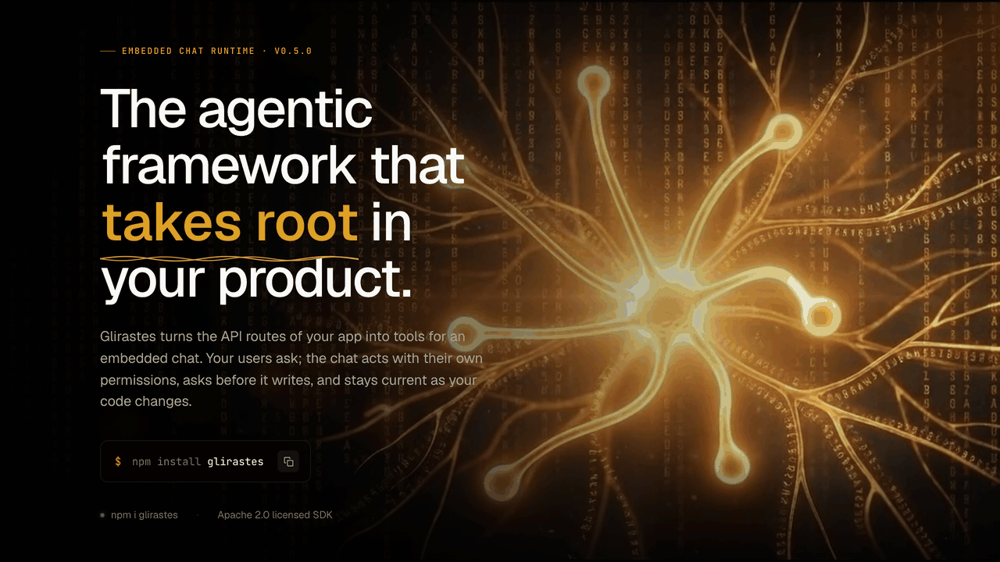
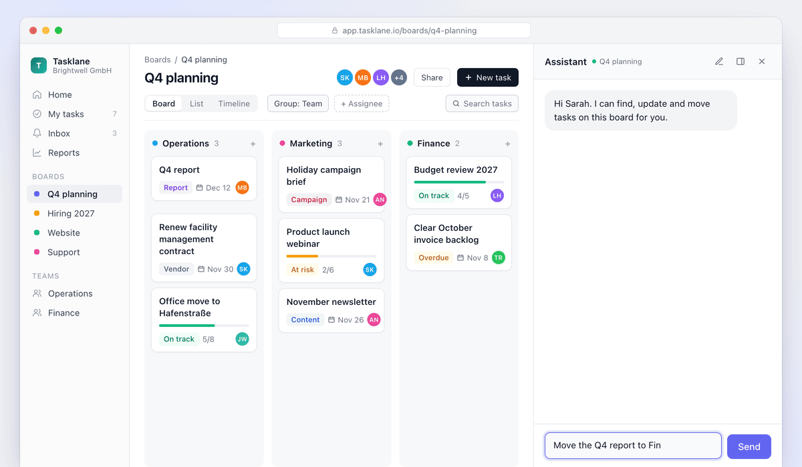

<p align="center">
  
</p>

<h1 align="center">Glirastes</h1>

<p align="center">
  <em>The agentic framework that takes root in your product.</em>
</p>

<p align="center">
  <a href="https://www.npmjs.com/package/glirastes"></a>
  <a href="LICENSE"></a>
  = 20.6">
  
</p>

<p align="center">
  <a href="https://glirastes.io"><b>Website</b></a> ·
  <a href="#quickstart-nextjs-app-router"><b>Quickstart</b></a> ·
  <a href="docs/"><b>Docs</b></a> ·
  <a href="skills/"><b>Skills</b></a> ·
  <a href="CHANGELOG.md"><b>Changelog</b></a>
</p>

<p align="center">
  <a href="https://glirastes.io"></a>
</p>

Glirastes is a TypeScript SDK for an embedded chat that operates your app: it
calls your endpoints, navigates, sets filters and triggers UI actions. The tools
come from your code, everything runs inside your app, and the optional Glirastes
Platform manages reviewed configuration and rollouts without ever seeing prompts
or business data.

## See it in action

<p align="center">
  
</p>

<p align="center"><sub>One request moves a card on a task board: the chat finds the task and the person, asks for approval of <code>tasks.update</code>, then acts.</sub></p>

## Quickstart (Next.js App Router)

**1. Install** the SDK and the chat peers (Node >= 20.6):

```bash
npm install glirastes @ai-sdk/openai @ai-sdk/react react-markdown
```

**2. Initialize.** Run it inside your Codex or Claude Code session, or from a
terminal with `--agent codex|claude`:

```bash
npx --no-install glirastes init
```

`init` writes `.glirastes/tools.json`, `.glirastes/prompt-bundle.json`, the
`predev` / `prebuild` scripts (`glirastes tools refresh`) and a short hint in
`AGENTS.md` / `CLAUDE.md`, installs the [agent skills](#agent-skills) and hands
the integration to your coding agent. Existing files are never replaced.
`--dry-run --json` previews without writing anything.

**3. Derive the tools** from your routes, pages, URL filters and client actions:

```bash
npx glirastes tools refresh
```

This writes the committed `.glirastes/` tool files and the generated module
`src/generated/glirastes/tools.generated.ts`.

**4. Add the chat route.** Identity comes from your verified session; your
endpoints keep their own authorization.

```ts
// src/app/api/chat/route.ts
import { createOpenAI } from '@ai-sdk/openai';
import { createGlirastes } from 'glirastes/runtime';
import { createAiChatHandler } from 'glirastes/server/nextjs';
import * as generated from '@/generated/glirastes/tools.generated';
import { resolvePrincipal } from '@/lib/glirastes-principal'; // your session lookup

const glirastes = createGlirastes({
  generated,
  localLimits: {
    maxModelSteps: 6, maxToolCalls: 8, totalTimeoutMs: 60_000, toolTimeoutMs: 15_000,
    maxInputTokens: 40_000, maxOutputTokens: 4_000, maxEstimatedCostUsd: 0.5,
    maxRepeatedFingerprint: 3, maxConsecutiveErrors: 3,
    delegation: { maxDepth: 1, maxBreadth: 1, sharedBudget: true },
  },
});
const openrouter = createOpenAI({ baseURL: 'https://openrouter.ai/api/v1', apiKey: process.env.OPENROUTER_API_KEY });

export const runtime = 'nodejs';
export async function POST(request: Request) {
  const principal = await resolvePrincipal(request); // { subjectId, tenantId, roles, attributes }
  if (!principal) return new Response('Unauthorized', { status: 401 });
  const turn = await glirastes.chatTurn((runtimeTenantId) => ({ ...principal, tenantId: runtimeTenantId }));
  return createAiChatHandler({
    ...turn,
    model: openrouter.chat('anthropic/claude-sonnet-5.5'),
    systemPrompt: 'Use the tools of this app. Ask one short question when the target is unclear.',
    toolDiscovery: true,
  })(request);
}
```

The handler protects the route for you. Set `GLIRASTES_APPROVAL_SECRET` (at
least 16 characters, the same on every instance) before production: it binds
each approval the handler asks for to the tool call, so a forged chat history
cannot run a tool; production refuses to serve approvals without it. Each
approval runs once per process; with several instances, pass a shared
`approvalStore` (e.g. Redis), or a replayed history can run once more on
another instance. The handler also answers 415 to a body that is not
`application/json`, 403 to a browser request from another origin (list yours
in `allowedOrigins`), 413 above `maxBodyBytes` (1 MB) and 400 to a history
that repeats a tool call id (`duplicate_tool_call_id`).

`executeTool` and routes built from `glirastes/runtime/ai-sdk` alone run a tool
without these approval checks; give them only input your server has authorized.

**5. Mount the chat** and the navigation bridge (client components):

```tsx
'use client';
import { useRouter } from 'next/navigation';
import { useGlirastesNavigationBridge } from 'glirastes/react';
import { VercelAiChat } from 'glirastes/react/vercel';
import 'glirastes/react/styles.css';

export function Assistant() {
  const router = useRouter();
  useGlirastesNavigationBridge({ push: (href) => router.push(href) });
  return <VercelAiChat endpoint="/api/chat" />;
}
```

**6. Run** `npm run dev` (the `predev` script refreshes the tools), then check
the setup with `npx glirastes doctor`.

The full walkthrough, including filters, client actions, `@` mentions and `/`
commands, is the bundled skill
[`integrating-glirastes-nextjs`](skills/integrating-glirastes-nextjs/SKILL.md).

## How it works

- **Execution is local.** The model call, the tool loop and every tool call
  run in your app's server. A normal chat turn makes no request to the
  Platform.
- **Your app keeps the sensitive parts.** Prompts, model calls and provider
  keys, secrets, business data, tool arguments and results, and final
  authorization stay in the app. `resolvePrincipal` only says who asks; each
  endpoint still checks its own session and permissions.
- **Guard rails per turn.** Each turn runs on one pinned tool and policy
  snapshot, with local budgets (steps, tool calls, tokens, cost, timeouts),
  loop detection and fail-closed authorization. Write and delete tools ask
  the user before they run.
- **The Platform gets metadata only.** A connected app sends content-free
  metrics (tokens, cost, latency, errors, tool use) in batches off the turn
  path, and receives signed configuration revisions.

## Tools from your code

`glirastes tools refresh` derives endpoint, navigation, filter and
client-action tools from Next.js, NestJS, OpenAPI (FastAPI), react-router and
vue-router sources, and from `useAiClientAction` registrations. The output is
committed with the code; `glirastes tools check` fails CI when it is stale.

```bash
glirastes tools refresh           # derive tools (--watch next to `next dev`)
glirastes tools status            # what the chat can do
glirastes tools check             # verify committed outputs, no model, no network
glirastes tools eval              # every example sentence finds its tool
```

**Policy.** Reads run directly, writes ask first, deletes and anything
external or financial always ask. Change that locally with
`glirastes tools policy` (`show`, `disable`, `confirm`, `relax`, `raise`,
`roles`, `exclude`, ...); it writes `.glirastes/tool-policy.json`. See
[docs/tool-policy.md](docs/tool-policy.md).

**Describing tools.** Glirastes itself never calls a model. Descriptions,
synonyms and example calls are written by a coding agent from work lists:

- **Free:** your own coding agent works through `glirastes tools resolve --print`
  and `glirastes tools describe --print` with the shipped skills
  `maintaining-glirastes-tools` and `describing-glirastes-tools`, and you
  commit the result.
- **Pro:** the managed CI tool agent (`glirastes tools enrich --managed`)
  runs the same skills in your CI, only on the tools a pull request or push
  changed, and commits the result as `glirastes-bot`. Model requests go
  through OpenRouter with the routing the Platform grants for the job (no
  data collection, zero data retention), or your own key in
  `GLIRASTES_TOOLS_OPENROUTER_KEY`. Requires the optional peer
  `@ai-sdk/openai`.

## CI

```bash
npx glirastes init --ci github [--enrich-on staging,main] [--ci-environment staging]
```

writes `.github/workflows/glirastes-tools.yml` for your package manager with
two jobs:

| Job | What it does | Needs |
|---|---|---|
| `glirastes-tools` | `tools check` and `tools eval` on every pull request and push to `main` | nothing: no secrets, no model |
| `glirastes-tools-enrich` (Pro) | runs the managed tool agent on pull requests and commits into the PR branch | variable `GLIRASTES_MANAGED_TOOLS=true`, variable `GLIRASTES_CONTROL_PLANE_URL`, secret `GLIRASTES_CI_KEY` |

- `--enrich-on <branch,...>` (or `--enrich-on-main`) also runs the agent
  after pushes to those branches; there it opens a pull request instead of
  committing, and the workflow gets a manual start that works the whole
  backlog once.
- `--ci-environment <name>` reads the three values from that GitHub
  environment instead of the repository.
- Set the variable `GLIRASTES_BOT_APP_ID` and the secret
  `GLIRASTES_BOT_APP_PRIVATE_KEY` to push as a GitHub App, so the bot's
  commits and pull requests trigger your checks. Without them the job uses
  the workflow token.
- An existing workflow with other content is refused unless you pass `--force`.

## Chat UI & speech

`glirastes/react` ships one chat implementation; `VercelAiChat` from
`glirastes/react/vercel` connects it to the AI SDK route.

- Docked sidebar or floating window (`AssistantWorkspace`, `AssistantToggle`),
  themes, slots, tool result renderers and approval cards.
- `useAiClientAction(id, handler, contract)` lets the chat drive UI state;
  `refresh` turns each registration into a tool.
- Generic `@` mentions and `/` commands derived from your tools
  ([docs/chat-interactions.md](docs/chat-interactions.md)).
- A per-message work log of tool calls and an optional plan checklist.
- `unstyled` to bring your own CSS; `deChatLocale` for German texts.
- Push-to-talk speech input through one STT controller (`voice` config,
  `glirastes/stt` adapters, `createRecordingTranscriptionHandler` for a
  server-side transcription route). Audio goes from the app to its own
  provider, never through Glirastes.
- Without React: the `<glirastes-chat>` element from `glirastes/embed` and the
  bridge in `glirastes/browser`.

See the skill [`building-glirastes-chat-ui`](skills/building-glirastes-chat-ui/SKILL.md).

## Standalone and Connected

| | Standalone | Connected |
|---|---|---|
| Trigger | no `GLIRASTES_API_KEY` | `GLIRASTES_API_KEY` is set |
| Network | none | Platform lookup, registration, sync and metrics, all off the turn path |
| Config | local code and `.glirastes/` | reviewed, signed, immutable revisions with rollouts and revocations |

`createGlirastes` from `glirastes/runtime` handles both. Connected, it falls
back to the local code whenever the Platform is unreachable and reports errors
to `onError` (operation and status only). `GLIRASTES_CONTROL_PLANE_URL` is
optional and defaults to `https://api.glirastes.chainmatics.io`; set it only
for a self-hosted or local Platform.

```bash
npx glirastes connect --base-url <platform-url>   # pair the app, writes GLIRASTES_API_KEY
npx glirastes sync                                # upload the current local setup
npx glirastes doctor                              # local checks, no network
```

The **Glirastes Platform** is the optional control plane: reviewed tool
configuration, signed immutable revisions, staged rollouts, approvals and
content-free health. **Free** covers the local SDK, the local skill workflow
and a connected app; **Pro** adds the managed CI tool agent. Details:
[docs/managed-runtime-sync.md](docs/managed-runtime-sync.md),
[docs/runtime-persistence.md](docs/runtime-persistence.md).

## Package surface

| Import | Purpose |
|---|---|
| `glirastes` | Shared types, tool definition helpers and diagnostics |
| `glirastes/runtime` | `createGlirastes`, local authorization, pinned turns, budgets, durable stores |
| `glirastes/server` | Server pipeline, including `createLocalAiPipeline` |
| `glirastes/server/nextjs` | Next.js handlers: `createAiChatHandler`, `createChatInteractionsHandler`, `createRecordingTranscriptionHandler` (alias `glirastes/adapter/nextjs`) |
| `glirastes/server/testing` | Test helpers for tool setups without model calls (ESM only) |
| `glirastes/react` | Chat UI, provider, hooks, client actions, navigation bridge, STT |
| `glirastes/react/vercel` | AI SDK transport and `VercelAiChat` |
| `glirastes/react/styles.css` | Shipped chat styles |
| `glirastes/stt` | Provider-neutral STT controller and adapters |
| `glirastes/ai-sdk` | Vercel AI SDK reference engine (alias `glirastes/runtime/ai-sdk`) |
| `glirastes/contracts` | Principals, budgets, manifests, revisions, deployments |
| `glirastes/sync` | Signed revision cache, rollout selection, revocations |
| `glirastes/embed` | `<glirastes-chat>` element for apps without React |
| `glirastes/browser` | Navigation bridge, query filters and client actions without React |
| `glirastes/codegen` | Route scanning and execution-inventory discovery used by the CLI |

## CLI reference

| Command | Purpose |
|---|---|
| `glirastes init [--agent codex\|claude] [--dry-run] [--json]` | Scaffold inputs, install skills, hand setup to your coding agent |
| `glirastes init --ci github [...]` | Write the GitHub tools workflow ([CI](#ci)) |
| `glirastes tools refresh [--watch] [--mode write\|frozen\|integrity]` | Derive tools from the code |
| `glirastes tools check [--strict] [--integrity-only]` | Verify committed tool outputs |
| `glirastes tools status` | Show what the chat can do |
| `glirastes tools resolve --print` | Work list of open findings for your agent |
| `glirastes tools describe --print [<tool>...\|--all]` | Work list of descriptions, synonyms and examples |
| `glirastes tools eval` | Check that example sentences find their tool |
| `glirastes tools verify <tool>...\|--all` | Confirm agent-written contracts after review |
| `glirastes tools policy <...>` | Change the local tool policy |
| `glirastes tools enrich --managed [--first-run] [--base <branch>]` | Pro, CI only: run the managed tool agent |
| `glirastes setup [--dry-run] [--managed]` | Validate and install the local setup artifacts |
| `glirastes setup inspect` | Inspect project manifests before integration |
| `glirastes connect --base-url <url>` | Pair the app with the Platform |
| `glirastes sync` | Upload the current local setup |
| `glirastes doctor [--managed] [--verbose] [--json]` | Diagnose the local setup |
| `glirastes install [--host a,b]` | Install the agent skills only |

`glirastes --help` lists every command and flag; `glirastes tools` and
`glirastes tools policy` print their own usage.

## Agent skills

The package ships seven skills in [`skills/`](skills/README.md) for your
existing coding agent (Codex, Claude Code, Gemini): `setting-up-glirastes`,
`integrating-glirastes-nextjs`, `integrating-glirastes-web`,
`maintaining-glirastes-tools`, `describing-glirastes-tools`,
`building-glirastes-chat-ui` and `migrating-to-glirastes`. `glirastes init`
installs them; `glirastes install --host codex --with-setup-skills` installs
them without starting setup.

## Support matrix

Next.js 15 App Router, React (Vite, react-router) + NestJS 11 and Vue 3 +
FastAPI are integrated and automatically checked. Exact levels and evidence:
[docs/support-matrix.md](docs/support-matrix.md).

## Docs

- [Support matrix](docs/support-matrix.md)
- [Tool policy](docs/tool-policy.md)
- [Chat interactions (`@` and `/`)](docs/chat-interactions.md)
- [Managed runtime sync](docs/managed-runtime-sync.md)
- [Runtime persistence](docs/runtime-persistence.md)
- [0.5.0 acceptance](docs/acceptance/0.5.0-acceptance.md)
- [Agent skills](skills/README.md)
- Examples: [`examples/`](examples/)

## Upgrading from 0.4

`0.5.0` is the first Foundation release. Its surface differs from
`glirastes@0.4.0`: exports, codegen APIs and CLI commands were removed or
replaced. Read **Breaking** in [CHANGELOG.md](CHANGELOG.md) before upgrading;
the skill [`migrating-to-glirastes`](skills/migrating-to-glirastes/SKILL.md)
covers moving off `@chainmatics/agentic-*`.

## Security & License

Report vulnerabilities as described in [SECURITY.md](SECURITY.md).
Contributions: [CONTRIBUTING.md](CONTRIBUTING.md).

Apache-2.0, see [LICENSE](LICENSE) and [NOTICE](NOTICE).
