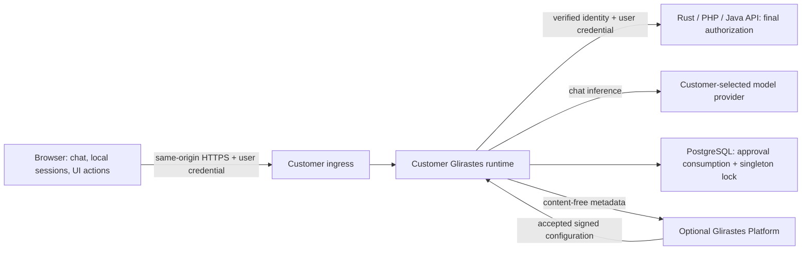

# Glirastes Runtime container V1

The runtime runs the existing SDK next to a Rust, PHP, Java or other HTTP API.
Customers supply an OpenAPI document, a backend identity contract and JSON
configuration; they do not write a Node server. A suitable existing Node/Next.js
server can continue embedding the SDK instead. `glirastes/server/http` is an
alias for the framework-neutral handler exports previously named `/server/nextjs`.

The official image is `ghcr.io/chainmatics/glirastes-runtime:0.22.0` for
Linux amd64. Use a pinned version (or digest) with matching artifact SDK version;
ARM users can build the supplied Dockerfile locally.

Start with the [public image and artifact commands](https://github.com/chainmatics/glirastes/blob/v0.22.0/containers/runtime/README.md),
the [PHP walkthrough](https://github.com/chainmatics/glirastes/blob/v0.22.0/examples/php-runtime/README.md), its
[JSON configuration](https://github.com/chainmatics/glirastes/blob/v0.22.0/examples/php-runtime/runtime.example.json) and
[Docker Compose](https://github.com/chainmatics/glirastes/blob/v0.22.0/examples/php-runtime/compose.yaml). The image is public and
does not require registry login. The [release record](https://github.com/chainmatics/glirastes/blob/v0.22.0/docs/acceptance/2026-11-15-runtime-container-v1.md)
separates container tests, publication and the embedded SDK's production rollout.

## Responsibilities and deployment



When an existing Node server embeds the SDK, that server takes the runtime box's
role. No additional service is required. The Platform is a control plane, not a
proxy between chat and backend. It cannot supply the customer's session, replace
backend permissions or host browser actions.

Run **one active service per application/environment**, independently of backend
replica count. PostgreSQL session locking rejects a second active service using
the same app/environment and database. This is an overlap guard, not HA fencing:
all instances must use the same database and namespace. Do not run multiple
independent stores or advertise zero-downtime failover. Use stop-before-start
updates. A real sidecar is only justified by instance-local access requirements.

The service executes model calls, tool discovery, permissions, confirmations and
HTTP tools locally using `createGlirastes().chatTurn()` and `createAiChatHandler`.
The Platform receives content-free technical metadata and supplies accepted
configuration/policy revisions. User credentials, arguments, results, chat and
prompts are not sent to the Platform. The configured model provider receives
content needed for inference. Frontend actions execute in the browser.

## Build and update tools

Export **OpenAPI 3.0.x or 3.1.x JSON** from the backend into the application
repository (YAML and Swagger 2.0 are not read; a 3.0 document's `nullable` and
boolean exclusive bounds are normalized to their 3.1 form on load).
The application CI must regenerate and diff this export: validating an already
stale document is not sufficient. Configure the normal `.glirastes/tools.json`
with a stable appId, targetAppKey and source:

```json
{"kind":"openapi","document":"api/openapi.json"}
```

To expose only selected operations, add `"selection":"opt-in"` and mark them
with `x-glirastes-tool: true` in the export; `x-glirastes-name`,
`x-glirastes-group` and `x-glirastes-roles` set their name, module and code
default roles. The [tool policy guide](tool-policy.md#openapi-source-selection-and-x-glirastes--extensions)
lists every extension with its precedence and invalid-value behaviour.

Use the existing SDK initialization/policy/description workflows for the rest of
the `.glirastes` inputs. Do not hand-edit generated tools, policy or app IDs.
The PHP reference includes a complete input project. No package.json is needed
for an OpenAPI-only project. Frontend navigation/actions can use the existing
supported source scanners; a navigation bridge alone discovers no routes.

```sh
# In the SDK checkout, or use the built image as the CLI (see container README).
bun install --frozen-lockfile
bun run build
node dist/runtime-service/bin.js build --project /absolute/customer-project --out /absolute/artifacts/release-1
node dist/runtime-service/bin.js validate --artifact /absolute/artifacts/release-1
# CI after committing generated inputs/outputs: a new destination, unchanged sources.
node dist/runtime-service/bin.js build --project /absolute/customer-project --out /absolute/artifacts/release-2 --frozen
```

Build reuses the SDK generator and binding validation. It produces `manifest.json`,
`runtime.json` and `coverage.json`. Directories are immutable: use a new directory
for a new release. Load checks SDK exact version, digest, app identity and schema
bindings. Hashes detect corruption, not malicious publishers; deploy trusted,
reviewed artifacts read-only. Customer executable JavaScript is never imported.

V1 fails builds for unsupported active operations, references or serialization.
Supported endpoint bodies are JSON objects; GET/HEAD/DELETE have no body. Query
parameters on POST/PUT/PATCH, custom header/cookie parameters, multipart,
required bodies that can be empty objects, external/recursive refs, unsupported schema keywords and mixed path placeholders
are not supported. Authentication belongs in `securitySchemes`, not model input
headers. Explicit `x-glirastes-ignore` or existing policy exclusions remain in the
coverage report. The build applies the generator's selection: operations marked
`x-glirastes-tool: false`, and with `"selection":"opt-in"` every operation without
`x-glirastes-tool: true`, are skipped (coverage lists them as `opted-out` or
`not-opted-in` unless an earlier reason applies); a selected operation that is
unsupported still fails the build. OpenAPI `servers` never selects a runtime API destination.

## Identity and permissions

Configure one fixed identity endpoint on the backend origin. It must validate the
forwarded cookie or bearer token and return exactly:

```json
{"userId":"42","tenantId":"business-a","roles":["editor"]}
```

Invalid sessions return 401/403. The response must contain no credentials or other
business data. The resolver is invoked again at tool boundaries; failures deny
execution. Runtime principal tenantId is the SDK's platform/runtime tenant;
subjectId is a SHA-256 of the business tenant plus user. Browser-supplied roles,
tenants and forwarded host headers are never trusted.

Every tool request forwards only selected credentials and adds verified
`x-glirastes-business-tenant` and `x-glirastes-user-id`. **Backend middleware must
compare both with the current authenticated session and reject a mismatch.**
This closes the race where a mutable session changes account/tenant after identity
resolution but before a mutation. These headers grant no permissions. Keep all
existing record/tenant/role authorization. A confirmation cannot override a 403.

Put the chat route under the app's public HTTPS origin. Session cookies must be
sent to that path. The host validates Origin and strips untrusted proxy-origin
headers. If the backend uses a CSRF token, configure `identity.csrfHeader`
(`x-csrf-token` or `x-xsrf-token`) and send it from the frontend. Do not disable
backend CSRF middleware. V1 has no OAuth exchange or token-refresh broker.

## Configuration and secrets

Configuration is strict **JSON**, not YAML or executable JavaScript. Unknown
fields fail. Paths for artifacts and secret files are absolute. See
`examples/php-runtime/runtime.example.json` for all required settings. Secrets
are read from mounted files; no shell/environment interpolation in the JSON.
Use a 32+ character random approval secret, a backend-scoped database account,
and separate model and platform secrets. Do not pass secrets to the frontend.

`platform: {"enabled": false}` disables Platform traffic; backend, model-provider
and PostgreSQL connections still operate. Connected mode needs
`enabled: true`, an environment slug and `apiKeyFile`; it requires an accepted
platform deployment before readiness. No automatic fallback on failed pairing or
startup sync. An already accepted SDK revision remains usable during a transient
platform outage; revocations apply when received. A cold restart waits for a fresh
accepted revision. This is not a guarantee of instantaneous remote revocation
while disconnected. Local SDK budgets remain hard upper bounds.

The model uses an OpenAI-compatible chat API, defaulting to OpenRouter. Configure
an operator-controlled `model.baseUrl` if necessary; it is a separate trust
boundary, not supplied by the browser/model. The container includes its provider.

Failed backend calls reach the model with their HTTP status and (capped)
response body, as in the SDK. The SDK's `classifyToolFailure` is a function
and cannot be configured in the JSON yet: in the container every failed
backend call counts as a tool error for `maxConsecutiveErrors` and the metrics.

Successful tool results are bounded for the model to 16,000 serialized
characters by default (the largest array is cut, then long fields, with a
`_truncated` marker and a hint). Set `application.maxResultChars` (integer,
1000 to 200000) to change the bound for every tool; an invalid value fails
config parsing. An operation's `x-glirastes-max-result-chars` in the export
wins for that tool and travels in the artifact's local tool contracts.
A result over the bound keeps a turn-scoped handle that the model reads with
the built-in `read_result` (see `docs/concepts.md`); `application.resultHandles:
false` turns that off, so large results are only cut.

An operation's `x-glirastes-output-allowed-fields`, `x-glirastes-output-denied-fields`
(also `**.<key>` at any depth, e.g. `**.fileUrl` for signed URLs) and
`x-glirastes-output-default-fields` travel the same way, as `outputAllowedFields`,
`outputDeniedFields` and `outputDefaultFields` in the artifact's local tool
contracts (absent when not declared; never sent to the Platform). The container
applies them like the SDK: fields outside the upper bound are removed before the
result is stored, shown or cut, and the first answer shows the default view. An
invalid allow- or deny-list disables the tool at build time; an artifact whose
lists are not valid field paths is refused when it is loaded.

Approval subjects ([approval-subjects.md](approval-subjects.md)): declared
`entityLookup`, `approvalSubject` and `lookupEffect` travel in the artifact's
local tool contracts; the artifact carries the exact SDK version, so rebuild
it after declaring. The container looks the records up through the declared
read tool with the forwarded user credentials and the pinned tenant and user
headers. `limits.approvalLookups` sets its local limits (`maxLookupsPerTurn`
32, `maxSubjectsPerCall` 4, `lookupTimeoutMs` 3000, `maxLookupTimePerTurnMs`
10000) or `false` turns the lookups off. They never count against
`limits.maxToolCalls`, which means calls made by the model.

Languages (all optional, section `chat`): `chat.locale` (BCP-47, default
English) is the language of the texts the runtime writes itself;
`chat.requestLocaleHeader` names a request header with the turn's language
(`accept-language` is read by preference, any other header holds one tag,
e.g. `x-app-language` sent by the chat's transport). With neither set, the
turn's language is the one the chat UI names in each request
(`Content-Language`, sent by the React/Vercel transport and
`<glirastes-chat>`; one BCP-47 tag, anything else ignored), else English;
`chat.locale` or `chat.requestLocaleHeader` replaces it: a fixed `chat.locale`
wins over the page language the chat sends, so set it only for a
single-language app. A language stored per user (the app's database) goes
into a header the chat's transport sends (`headers: { 'x-app-language':
user.language }`), named in `chat.requestLocaleHeader`; pass the same value as
the chat's `language` so its built-in texts match. `chat.locales` adds or
changes the runtime's own texts per language (`{"pl": {"closing": "...",
"silentTurn": "...", "streamError": "..."}}`, keys of the SDK handler's `locales`; partial tables
fall back per key, an unknown key fails at start). The artifact carries the
tool labels per language (`.glirastes/tools.json` `languages`, by default
en, de and every declared language; local, never sent to the Platform), and
the approval card and step display show them in the turn's language.

UI action outcomes (optional): `chat.uiActionOutcomes` is `confirm` (default),
`report-only` or `off`, the handler's `uiActionOutcomes` (see
[UI action outcomes](ui-action-outcomes.md)). With `confirm` a turn with a UI
action takes two POSTs to `chatPath`, each its own request with its own
budgets and its own place in `maxConcurrentTurns`; a turn can cost up to four
times the per-request budgets. A strict proxy in front of the container must
allow the body field `glirastesUiOutcomes`. The shape of a UI tool result
is not configurable here: the container follows the SDK default
(`uiToolResultShape: 'auto'`), so a request with that field gets
`{ handedOff: true, … }` and every other request the 0.17.3 shape
`{ success: true, … }`.

The model history uses the SDK defaults (`history`, `maxContextMessages`):
since 0.18.0 `history.toolTurnCounting` is `tool-turns` and the seen-objects
memo is on for tools with declared identity (see
[History measurement](history-measurement.md)). `chat.history` (optional,
strict) is the way back: `{"toolTurnCounting": "all-turns", "seenObjects":
false}` restores the 0.17 model input; each key is optional (`all-turns` or
`tool-turns`, `true` or `false`), any other key fails at start. The other
history limits keep the SDK defaults. The debug hook
`onModelInput` is embedded-only by design: it carries prompts and tool
results, and the container's stdout carries content-free events only.

## State, cancellation and lifecycle

PostgreSQL stores only hashed consumed approval IDs, scope and expiration. The
SDK still signs and verifies the complete approval binding. The host derives the
signing key from the master secret and app/environment, preventing cross-environment
replay even when a master secret is accidentally reused. Atomic consumption,
quotas and expiry (including clock skew) survive restart. Never rotate approval
secrets to a different value during an in-progress approval flow unless intending
to invalidate it. SQL initialization creates the store table/indexes; use a
restricted schema/search_path and appropriate deployment-time DDL permissions.

Browser-local conversations use `createLocalSessionStore` with a storage key
including app, environment, business tenant and user. Recreate the UI/session
store on sign-in or tenant change and clear sensitive local state on logout as
required by the application. V1 does not provide server history, cross-device
resume, or automatic continuation after a process crash.

Request cancellation reaches model and HTTP calls. A completed backend write
cannot be rolled back by cancelling chat. A write with an unknown outcome is not
automatically retried; use backend idempotency where required. Approval consumption
before a failing HTTP request can require a new approval; it is not a distributed
transaction or exactly-once mutation guarantee.

`GET /healthz` is liveness. `GET /readyz` also checks PostgreSQL, active lease and
managed readiness. SIGTERM stops accepting new work, drains streams, then aborts
remaining requests and closes connections. Configure ingress stream buffering off
and timeouts longer than the total turn timeout; do not automatically retry POST
chat requests. Bound concurrency and body/response sizes are configurable.

The image runs non-root. Mount config/artifacts read-only, use a read-only root
filesystem and tmpfs for `/tmp`, drop capabilities and limit network egress to the
fixed backend, database, model and optional platform. Private backend addresses
are intentionally allowed; network policy is the operator's boundary. Redirects
are denied, paths are prefix-restricted and caller-selected destinations rejected.

Logs contain event type, trace ID, HTTP status and duration. Raw exception messages,
credentials and chat/tool payloads are omitted. Provider output-schema diagnostics
must likewise remain content-free. Pin image digests and deploy the matching SDK
browser package/artifact version together. Normal builds do not publish. An authorized release tag publishes the tested
versioned image to `ghcr.io/chainmatics/glirastes-runtime:<version>` and the npm
package. Customer deployment remains separate.

## Acceptance

`tests/runtime-container-e2e.mjs` exercises a real PHP API and PostgreSQL, a
scripted OpenAI-compatible provider and the production HTTP host. The optional
image mode tests the built runtime image. Browser tests use the existing embed
and frontend action bridge. See the fixture README for commands and exact coverage.
A deterministic model proves transport and authorization behavior; a provider
account smoke test is a separate customer acceptance step and incurs usage.
